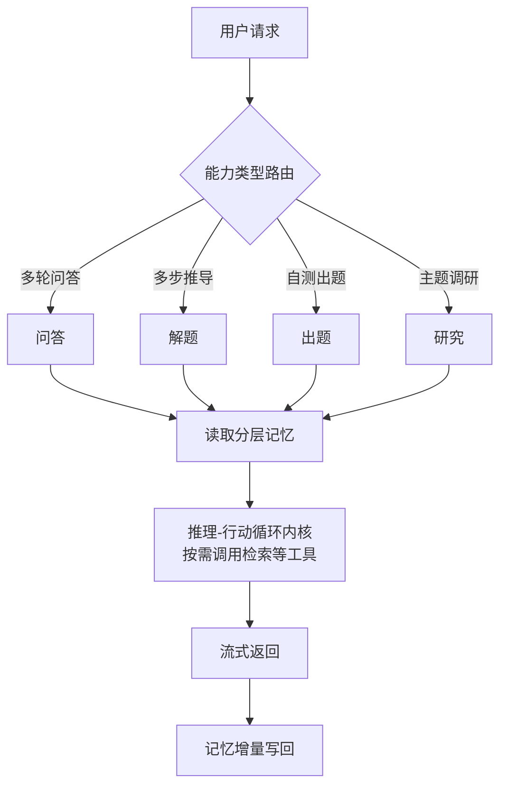

# 面向教学的课程助手智能体设计与实现

——以《电路分析基础实验》课程为例

**Design and Implementation of a Course-Specific Agent for Experimental Teaching: A Case Study of Fundamentals of Circuit Analysis Laboratory**

> 作者：×××，×××，×××（姓名、单位、邮编待补）
> 基金项目：×××（如有，待补；若列国家自然科学基金、国家重点研发计划或省级自然科学基金，须在文中提供项目名称、项目负责人及承担单位）
> 通信作者：×××，E-mail: ×××（第一作者为研究生时，须以导师为通信作者）
> 中图分类号：TP391；G642.423　　文献标识码：A

---

## 摘要

目的：解决电路基础实验课程中理论与操作脱节、课时内答疑集中、学习过程缺乏连续记录三个问题。方法：以工具调用驱动的推理—行动循环为统一调度内核，承载问答、解题、出题、研究四类能力；索引层按讲义版面特点采用标题层级栈驱动的结构化切分，并提供知识图谱与向量双后端按库选型；上下文治理按跨请求稳定性对提示词分层，并以有效上下文窗口实施预算规划与优先级驱逐；学习记忆按遗忘边界与更新代价分为三层。结果：系统已在该课程完成部署，回答可追溯至讲义片段、资料未覆盖时显式拒答，推理全部经外部接口完成而无需图形处理器。结论：该设计可为同类课程智能体建设提供参考。

**关键词**：课程智能体；检索增强生成；结构化切分；上下文管理；实验教学

**Abstract**: Objective: To address three problems in fundamental circuit laboratory courses—the gap between theoretical statements and hands-on operation, the concentration of question-answering requests within limited lab hours, and the absence of a continuous record of the learning process. Methods: A tool-calling reasoning–acting loop serves as a unified scheduling kernel carrying four capabilities: question answering, problem solving, quiz generation and research. The indexing layer adopts heading-hierarchy-stack-driven structural chunking tailored to the layout of laboratory handouts, and offers a knowledge-graph backend and a vector backend that can be selected independently per knowledge base. Context governance stratifies the system prompt by cross-request stability and performs budget planning and priority-based eviction over an effective context window, while learning memory is divided into three layers according to forgetting boundaries and update cost. Results: The system has been deployed for the course Fundamentals of Circuit Analysis Laboratory. Answers are traceable to specific handout fragments, the system refuses to answer explicitly when the course material provides insufficient evidence, and all inference is performed through external service interfaces without requiring a local GPU. Conclusion: The design provides an engineering reference for building similar course-specific agents.

**Keywords**: course-specific agent; retrieval-augmented generation; structure-aware chunking; context management; experimental teaching

---

## 0　引言

随着大语言模型不断飞速发展，基于其而构建的学习系统也开始进入高校教学环节，"课程助教"类系统已从概念验证阶段进入到工程落地阶段。就现有公开数据，这类系统大致沿两条技术路线展开。

一是**参数微调路线**。陶飞飞等[1]以《操作系统原理》课程为实验对象，采用低秩适配方法微调开源模型，并利用大语言模型自动构造了约七千条课程指令数据集用于训练；张友衡等[2]针对《编译原理》课程实验，同样以微调开源模型为主要手段。该路线的优势在于模型输出风格与课程内容高度贴合，代价是课件更新即需重新构造数据并重新训练，单课程的边际成本较高，且模型内部知识与课程资料之间缺乏显式的对应关系，无法满足"结论出自哪一页讲义"这类可追溯性要求。

另一条路线是**检索增强生成路线**。张力军等[3]为《计算机网络》实验课程构建了二十万字规模的知识库，采用稀疏与稠密双路召回后做倒数排名融合，并设置多级规范性检测用于拒答；潘耀宗等[4]将知识图谱与文本向量并置为双路知识体系，按实验阶段设计不同的提示模板；张希坤等[5]进一步引入智能体框架，将前端交互、智能体调度、混合知识库与日志分析分层组织，并在实验班中开展对照观察。与本文课程类型最接近的是陈宇等[6]面向电力电子实验教学的工作，其以智能插件补足通用大模型对本领域符号系统与器件参数的理解缺口，说明电类实验课程的难点不在模型规模而在领域资料的组织方式；陆玲霞等[7]则将大模型用于嵌入式微处理器实验报告的智慧评阅，把此类系统的作用面从答疑指导扩展到教学评价。

跨学科的同类工作亦呈现相近取向：文献[8]面向大学物理实验建设教学辅助智能体并开展准实验对比，文献[9]将大模型用于数字系统实践课程的代码分析与自动评分，文献[10]提出在缺乏学生反馈时以历史提问自动构造测试集并结合专家校验的评估框架，为"以离线评测替代课堂实证"提供了方法论依据，文献[11]将模型上下文协议引入智能导学系统的多智能体编排，说明协议化的工具接入正在成为该类系统的组织方式之一。此外，也有工作直接在低代码平台上搭建电路课程学伴[12]，其局限在于解析、切分、检索、拒答等关键环节不可控，难以针对课程特点定向优化，亦无法开展控制变量的对照分析。

综合来看，现有研究已在单个功能层面较为完备，但在工程的技术细节以及系统的AI化程度上尚存在薄弱环节。多数工作将检索增强生成作为一个整体模块进行引述，而对最终检索效果有重大影响的因素——讲义文档如何解析与切块、多路检索结果如何融合、证据不足时如何判定并拒答——则少有交代，这些细节恰恰决定了系统能否真正被学生所接受。此外，真正意义上的智能化课程助教不应停留于一问一答，而需要准确感知学生的当前知识水平、历史学习情况与学习偏好，并能自主判断何时调用课程资料之外的其他工具。

针对上述问题，本文以《电路分析基础实验》为案例课程，设计并实现了一个课程助手智能体系统，其核心贡献是一项主创新与若干支撑工作。

（1）代价敏感的跨会话学情拼接门控。已有课程助手多将跨会话学情在每轮回答中无条件注入，由此带来答非所问的干扰。本文将"本轮是否把学生未问及的薄弱点随回答一并带出"建模为一个可单测、可向教师解释的决策：以建库时一次性抽取的课程先修主题图为坐标，由问句命中的主题沿先修边回溯出该生尚未掌握的前置缺口，结合其在此缺口上的遗忘概率与错题复发情况计算需求概率，再按价值—成本权衡在"完整简报／一句轻提醒／沉默"三档中取净价值最大者；其中"漏报（下次仍错，实验中可能损坏仪器）重于误报（答非所问）"的代价不对称来自实验课程的固有安全结构。该门控读侧为纯规则，不含生成式模型调用。

（2）学情估计与课程结构层。建立课程级先修主题图（建库时抽取、教师可审计、运行时无需生成式调用）；掌握度采用"感知与记账分离"的估计结构——大模型仅在主题闭集内做可弃权、须附原文引用的等级判定，数值由确定性的 Elo 更新规则从追加式观测日志折叠得出，所有学情判断均可溯源至具体对话证据（掌握度估计沿用教育数据挖掘的成熟做法，不作为本文创新，详见 §3.7），为门控提供数据层。

（3）工程基座。包括以工具调用驱动的统一调度内核（承载问答、解题、出题、研究四类能力）、针对实验讲义版面的标题层级栈结构化切分、向量与知识图谱双索引后端、按跨请求稳定性分层的上下文预算治理与三层学习记忆系统。

---

## 1　教学需求分析

《电路分析基础实验》是电类专业的核心基础实验课程，课程内容覆盖基尔霍夫电流与电压定律、叠加定理、戴维南与诺顿等效等知识点，要求学生既理解定律与等效变换的理论表述，又能完成接线、测量、记录与误差分析等操作环节。结合课程教学实际，系统建设面向三个具体问题。

**问题一：理论表述与实验步骤之间缺乏可操作的中间层。** 学生在课堂上能够复述定理内容，但在实验台前往往不清楚测量顺序、不理解某一步骤的目的，测量结果与理论值不符时缺乏排查思路，最终表现为跟做实验、报告模板化。系统需要能够针对具体实验任务给出分步推导与操作提示，而非仅复述教材定义。

**问题二：实验课时内答疑请求高度集中。** 实验课通常多组学生同时进行，同一时段内的提问在时间上高度集中且在内容上高度重复。基础较弱的学生反复卡在同类问题上，基础较好的学生希望获得更深入的推导，仅靠教师现场巡回难以兼顾。系统需要承接共性问题的即时应答，使教师的时间可以投向关键问题诊断。

**问题三：学习过程缺乏跨阶段的连续记录。** 学生在预习、实验、复盘三个阶段的提问与易错点分散在不同媒介中，既无法在后续交互中被复用，也难以为教师的分层指导提供依据。智能体需要在会话内与跨会话两个尺度上沉淀学习轨迹，并在后续回答中体现。

由上述问题导出四项设计目标：回答须可追溯到课程资料中的具体片段；课程资料未覆盖时须明确拒答而非以通用知识强答；交互过程须可视、可中断，以适配实验课堂的即时反馈节奏；系统须能够在无图形处理器的服务器上长期运行，以匹配院系实验室的部署条件。

---

## 2　系统总体架构与功能组织

系统采用前后端分离架构，前端基于 React 与 TypeScript 实现课程选择、会话管理与流式渲染，后端基于 FastAPI 实现接口层与调度层，以 PostgreSQL 承载业务数据与向量数据、以 Redis 承载缓存与任务队列。

总体处理流程如图 1 所示。用户请求进入后，调度层先按前端指定的能力类型完成路由，随后统一进入共享的推理—行动循环内核；内核执行过程中读取该用户的分层记忆作为上下文补充，按需调用课程知识库检索、联网搜索等工具，执行结束后将本轮交互的增量信息写回记忆存储。

**图 1　系统总体架构与请求处理流程**

系统面向用户提供四类功能入口，其问答、解题、出题、研究四类能力的划分借鉴自 DeepTutor[33] 的学习模式组织，由前端指定，定位与执行方式如表 1 所示。四类能力均建立在同一套调度内核之上，差异仅体现在各自配置的工具集合与阶段划分上。这一组织方式的直接收益是内核层的可靠性改进（超时处理、异常兜底、上下文预算治理、成本记账）对四类能力同时生效，无需维护多套重复的编排逻辑。

**表 1　四类功能的定位与执行方式**

| 功能 | 定位 | 执行方式 |
|---|---|---|
| 问答 | 面向课程内容的多轮交互问答，回答优先基于检索到的课程资料 | 单次循环执行，提炼用户关键词后按需调用检索、联网搜索等工具 |
| 解题 | 面向需要多步骤推导的问题，要求先给出完整计划再逐步执行 | 单次循环配合独立于模型推理的计划状态机，强制"先规划、再执行、不可跳步"，重新规划次数受上限约束 |
| 出题 | 按要求自动生成练习题目 | 三阶段：素材检索、蓝图规划（确定题目数量与题型）、题目并行生成 |
| 研究 | 面向指定主题的深入调研，产出附带引用来源的报告 | 四阶段：主题澄清、子问题拆分、并行检索取证、报告生成 |

其中解题任务的"计划完整性"与"不可跳步"由表 1 所述状态机保证而非仅依赖提示词层面的建议，因而成为可验证的执行约束；出题任务将蓝图规划与逐题生成分离并允许并行，使单题失败不影响其余题目；研究任务要求每条结论均关联具体检索来源并以编号标注出处。

---

## 3　关键技术设计

### 3.1　多能力共享的调度内核

调度内核采用以工具调用驱动的推理—行动循环[13]：模型在每一轮自主判断是否需要调用工具，需要则执行调用并观测结果，据此决定继续调用还是给出最终回答；模型不再发起工具调用时循环结束。内核对外只产出与传输方式无关的事件（阶段起止、模型增量输出、工具调用状态、最终答案），因而同一套执行逻辑可同时支撑网页问答的Http单向流式响应，与深度能力的澄清反问、任务取消、追加输入等使用Websocket全双工协议。

### 3.2　面向实验讲义的结构化解析与切分

本课程实验讲义文档的版面特征是：章节层级明确、存在大量表格承载关键参数（元件规格、量程设置、测量记录格式）、图文混排比例较高。早期实现按固定字数机械切分，不感知标题层级与表格结构，导致大段表格被从中间截断、片段脱离所属章节语境。

改进后的方案由三部分构成。首先，解析层将 PDF、DOCX、PPTX 等格式统一转换为带章节层级与页码元数据的结构化中间表示（Markdown），其中 PDF 引入版面分析与表格结构识别以替代按页面顺序提取文本的做法[14]，并按标题层级完成分节——解析只负责还原结构，不涉及切分。其次，切分层引入标题层级栈，以文档自身的章节层级约束切分边界，并将表格作为独立单元整体保留以避免跨行截断；层级感知切分相较于固定字数切块对检索准确度的提升已在长篇工业文档场景得到验证[15]，实验讲义在"章节层级明确、表格承载关键参数"两点上与该场景同构，故本文沿用其切分边界约束思路。文档中被识别到的图片部分采用视觉语言模型（VLM）生成描述文本并拼入所属片段。最后，切分粒度由固定较大值调整为更小的可配置参数，同时为每个片段补充上下文摘要，说明该片段在原文中的位置与背景，以补偿粒度变小带来的语境损失——已有实践表明，为片段补充其在全文中的定位信息可使检索失败率由 5.7% 降至 3.7%[16]。

图：每个切块补充背景以及定位信息

### 3.3　双索引后端与检索路由

课程内容的检索需求并不单一：部分问题需要跨知识点的关系推理（如"戴维南定理与诺顿定理之间有何联系"），另一些问题只需定位某一知识点的原文表述（如"实验三中电流表的量程如何设置"）。两类需求对应不同的索引构建方式，对构建成本与检索能力的要求不同，单一方案难以同时满足，因此系统允许每个知识库独立选择索引后端，二者对比见表 2。

**表 2　两种索引后端的特性对比**

| 维度 | 知识图谱索引 | 向量索引 |
|---|---|---|
| 索引原理 | 逐文本块调用大模型抽取实体与关系并建图 | 复用已切分文本块，仅做向量编码 |
| 构建耗时 | 随语料规模近似线性增长，大规模课件需数小时 | 分钟级，可批量并发 |
| 检索能力 | 图谱邻域扩展结合向量检索，支持多跳关系推理[17] | 稠密与稀疏并行召回后融合，面向精确事实检索 |
| 适用场景 | 需跨材料综合推理的课程 | 课件规模大、以事实定位为主的课程 |

向量存储选用关系数据库的向量扩展而非独立的专用向量数据库：其近似最近邻搜索算法[18]在本项目的向量规模内性能已经足够，且索引数据与业务数据统一存储可避免额外的运维成本与硬件资源开销，这一权衡更贴合院系实验室的部署条件。检索模式可由用户指定，分别走图谱增强检索与向量检索两条路径。

### 3.4　混合检索、排名融合与交叉编码器精排

稠密检索把提问与文档均嵌入为向量后做余弦相似度检索，能查到语义相近但措辞不同的内容；稀疏检索则对器件型号、编号、专有名词等精确词汇的召回更可靠，二者互补。系统对两路分别独立查询后做倒数排名融合（RRF）[19]，使两路不同量纲的结果能按各自的排名位置计算融合得分；由于两路面向同一存储表、片段标识天然一致，融合无需额外的跨存储对齐步骤。

多路召回解决的是不漏信息，融合解决的是初步排序，但 RRF 仍基于各路召回器的独立打分；交叉编码器（Cross-Encoder）则把查询与每个候选片段一起送入模型，直接输出相关性分数。组件消融研究表明，在多阶段流水线中引入交叉编码器精排可带来统计显著的质量提升，且因其只对少量候选做一次前向计算，相对于流水线中的大模型调用其延迟开销可忽略[20]；

召回与精排解决"找得到"，而教学场景更关键的是"找不到时不要硬答"。已有研究表明，检索噪声对大模型的影响并非完全有害，但与问题无关的噪声会明显拉低回答准确性[21]，因此系统在精排之后设置三层门控：无命中判定层在召回为空时直接返回拒答，工具层拒答约束模型在工具未返回有效证据时不得自行作答，两者常开；相关性阈值层默认关闭，需在开启精排并完成分数标定后启用，以避免未标定的阈值把正确片段一并滤除。

### 3.5　上下文预算治理与提示词分层

多轮工具调用会使消息列表迅速膨胀，而模型真正有效的上下文窗口显著小于其标称值：重要线索位于序列首尾时模型能够可靠利用，但对中间位置关键信息的提取能力大幅下降，即"Lost in the middle"现象[22]；长上下文基准的实测进一步显示，全部受测模型均声称支持 32K 以上上下文，但仅约半数能在 32K 长度维持质量阈值，且几乎所有模型在达到标称长度前就已跌破阈值[23]。基于此，本系统实现以下两项设计。

**提示词分层。** 系统提示词由执行规范、课程配置、技能说明、工具提示、跨会话记忆、会话摘要等来源拼接而成，拼接顺序按"跨请求稳定程度"从高到低排列：全局恒定的在最前，课程级与用户级配置次之，每次请求都可能变化的记忆与时间放在最后。由于键值缓存只能复用请求间完全一致的前缀，这一排序可最大程度提高前缀缓存命中率，从而同时改善首字延迟与 token 消耗。

**回合与轮内预算。** 系统设置安全线与质量线两条阈值：安全线由模型标称窗口扣除输出预留与安全余量得到，是触及模型超界后拒绝回答的边界；质量线显著低于安全线，越过它便启动自动压缩。两条线均由标称窗口按比例换算而非取固定值，从而在改善标称窗口与有效窗口的系统性落差[23]的同时，不至于浪费长窗口模型的容量优势[24]。一轮问答开始前依据质量线规划历史消息：未超阈值时不作裁剪，超出且存在会话摘要时裁切为质量线的一半，否则裁切到质量线。轮内则在每次模型调用前按代价递增级联降低预算：先将更早轮次的工具结果按优先级清理为掩码标记（保留最近若干轮不动，携带来源引用段的检索结果优先级更高），以十余字的掩码替换数千字的原始工具输出，可在不丢失对话语义的前提下显著降低预算，且其成本收益优于整段摘要压缩、不易引发任务轮数变长[25]；若仍超质量线，则追加一次大模型调用把被清理内容折叠为摘要块；若仍超安全线，则丢弃最旧部分消息以保证请求可送达。

### 3.6　三层学习记忆

记忆系统按遗忘边界与更新方式的不同划分为三层，其写入与读取路径如图 2 所示。

**图 2　三层学习记忆的写入与读取路径**

**L1 短期记忆**根据当前模型的上下文容量换算出 token 预算，从最新消息向前逐条累加直至超出预算窗口进行截断，窗口长度根据所选模型的不同而自适应调整；token 计数优先使用分词器精确统计。

**L2 会话摘要**在消息量超出窗口一定量后触发，用于在原文滑出窗口后保留关键信息。压缩以增量方式进行：维护一个记录已压缩位置的游标，每轮只处理游标之后、窗口边界之前新增的这一小段历史。摘要时让大模型从新增片段中按预定义结构（讨论主题、已达成结论、确认的事实、未解决问题、后续约定）抽取为结构化数据，再由代码逻辑与已有摘要归一化去重合并，每类信息按条数上限保留最近若干项。分层摘要与选择性注入的思路参考了树形摘要检索的相关工作[26]。

**L3 长期记忆**跨会话保留关于学生的事实性片段（学习偏好、个人特点、薄弱知识点等）。写入先进入按用户与会话分桶的缓冲队列，由后台任务在累积重要度点数达阈值或静默超时后批量处理，而非每轮即时写入——已有研究表明，以话题分段而非单轮对话作为记忆构建粒度并配合片段压缩去噪，可同时提升记忆检索准确率与所取内容的语义完整性[27]。其中稳定的学习者事实（讲解偏好、学习目标与考试节点、教材与器材版本、时间与设备约束等）由一次受白名单约束的大模型抽取产生：抽取指令限定可写出的记忆类型、明确排除掌握度结论与题目内容，并以返回空的负例约束"无可抽事实"的情形——相对于关键词触发式抽取，该方式能覆盖无触发词的表达（如"讲慢一点"这类讲解偏好），且掌握度结论在写入契约上即被排除在个人事实槽之外（真正的掌握度状态由 §3.7 的观测日志承载，两者单一职责）。读取链路在语义检索之外叠加矛盾抑制：对文本相似度超阈值且写入时间相隔超过最小天数的两条记忆判定为同一事实的前后版本，注入时只保留较新一条，该判定基于字符串相似度、不额外消耗模型调用。之所以保留这一读侧抑制，是因为所采用的开源记忆库其抽取链路为追加式、无原生更新操作，同一事实的变化会以新条目形式累积，读侧必须自行判重。记忆分层的总体思路借鉴了将上下文窗口类比为分级存储的设计架构[28]，差异在于本系统的层间流转由确定性规则触发而非交由模型自主决定，以换取行为的可测试性。

### 3.7　学情模块与学情拼接门控

学情模块以课程主题为坐标，为学情拼接门控提供可计算、可溯源的学生知识状态。其原理为：建库时利用llm抽取课程主题闭集与课程主题的先修关系；大模型在闭集内对对话作等级判定，答题判分按同一口径入账，两类证据统一写入观测日志；确定性 Elo 规则把日志折叠为掌握度；掌握度再与遗忘耦合换算为"此刻有多需要被提醒"的需求概率；门控据此决定本轮是否提醒学情、说多少。贯穿其中的分工原则是把**感知**与记录分开：前者交给大模型，后者由确定性数学模型完成。

**课程结构层。** 课程主题及其先修关系是判断学生掌握度的前提条件。系统在教师建立知识库索引的同时也完成这一步：由大模型从课件中抽取知识点、去重后判定其间的先修关系，产出课程主题闭集与先修图并落库。递归式先修知识追踪等工作在运行时由大模型递归发现前置关系，虽无需预建图，但前置边不可单测，且不同学生可能会得到不一致的结果；本方案以建库时的一次性离线抽取换取运行时的确定性与可审计性。

**闭集序数判定。** 后台巩固任务把对话按主题连续段切分，对每段发起一次判定调用：输入为该段全部轮次原文与命中的课程主题（至多 3 个）及其定义，模型对每个主题输出三档等级（未掌握／部分掌握／已掌握）或显式弃权，并附逐字取自原文的引用。让模型判等级而非直接给出分数增量，是因为序数判断落在其能力范围内，而分数增量缺少可标定的含义。三条硬约束在代码层校验：主题标识只能取自闭集、引用非该段子串则该条判定作废（可测量的幻觉率）、判不出即弃权（以弃权率换精确率）。答题判分为第二类证据，题面经闭集最近邻映射后按同一口径记入观测。

**观测日志与 Elo 折叠。** 两类证据统一追加至观测日志表，每条含主题标识、证据来源、结果取值、来源权重与时间戳；掌握度不直接写入，而由确定性 Elo 更新规则按时间序折叠全量日志得出——期望正确率为学生能力与主题难度之差的 sigmoid，更新步长随观测次数递减并设下界[34]；主题难度为全班共享参数，仅由判分观测更新，单个学生单段对话的观察不冒充班级难度证据。选 Elo 而非贝叶斯知识追踪，是因其无需训练数据即可冷启动，难度参数又天然充当班级先验。

**遗忘耦合。** 掌握度只回答"会不会"，是否值得提醒还取决于"多久没碰过"。系统按 p_forget = 1 − exp(−t/S) 估计遗忘概率（t 为距上次召回的天数，S 为记忆强度、每次被肯定则递增，借自记忆强度间隔效应的建模[35]），需求概率取其与薄弱风险之积 p_need = risk × p_forget：刚被判为薄弱说明学生正在学、不预警，久未触碰才值得提醒。错题复发信号不乘遗忘项，因为复发是错题信号而非时间信号。

**门控的候选集。** 跨会话学情不被无条件注入每轮回答，门控只在两类候选上计算。一是前置缺口：取问句命中主题的先修闭包减去命中主题本身，再与该生薄弱主题求交——全库薄弱点禁止入闸，"不拼无关学情"由结构保证而非依赖模型自觉；入闸判据在 logit 空间设定，阈值由"同一主题至少两次被判未掌握"这一可陈述规则反推得出，而非手工调参。二是错题复发：命中主题本身在 30 天窗内的同主题失败观测计数 ≥ 2，由观测日志派生而非错误标签聚类——后者依赖模型自由生成标签的字符串同一性，实际不成立。

**三因子三档决策。** 门控以最大化召回学情的信息效用为目标[36]，三因子为置信度、任务风险与认知负荷。置信度 c 由匹配相似度经阈值归一得到（刚过匹配阈值取下界、完全匹配取 1）——匹配含糊时预警可能指错前置，效用应打折；任务风险为需求概率与证据主题安全权重之积，权重默认取 1，教师可对安全关键主题（如通电操作）调高、对"永不因它预警"的主题置 0；认知负荷为两档开口动作各自的固定成本。据此取 value = p_need × severity × c，比较三个动作的净价值：full = value − 0.30、light = 0.6 × value − 0.12、silent = 0，等价边界为 value < 0.20 沉默、0.20 ≤ value < 0.45 一句轻提醒、≥ 0.45 完整简报；同一证据主题 24 小时内实际拼出过则直接沉默，依据是对照实验中主动干预虽提升交互量却降低学习者的感知控制[37]。单阈值代价敏感版本[31]保留为消融对照臂：其等价边界 p_need ≥ 0.434 落在轻提醒带内部，单阈值结构只能把这一量级的场景整体升为完整简报或整体沉默，三档结构则把中间带留给一句轻提醒。

**两条读路径的分工。** 跨会话学情进入本轮提示词有两条按结构分工的读路径。第一路是相似历史检索：以本轮问句为查询，从长期记忆中召回个人事实与同主题历史学习事件，注入时限定每槽条数与单条长度、仅保留与命中主题相同的学习事件，并以提示词约束其用途（调整讲解方式，不得据此对该生掌握程度下结论、不得主动展开本轮未问及的知识点）。第二路即上述门控，独占"是否提醒未问及的薄弱前置"这一决策。两路以去重约束衔接：门控本轮已开口的证据主题不再进入第一路的注入。第一路的相似度召回与限量注入是智能助教系统的标配底座、不作为本文创新，其意义在于被分工约束住——若它无门控地复述学情，便会绕过门控建立的节流机制。

### 3.8　技能与外部工具的渐进式披露

随着可用工具与课程技能的增多，若将全部工具描述常驻于系统提示中，上下文长度将随技能数量线性增长，且大部分描述在单次会话中并不会被使用。故系统采用渐进式披露：系统提示词中默认只提供技能的简要描述与工具名称提示，当模型判断需要调用某项能力时，再通过内置的工具加载接口获取完整说明。除内置工具外，系统还通过模型上下文协议（MCP）接入外部工具，由网关进程统一维持连接、管理员侧统一部署、学生侧按需开启，其在系统提示中同样只写入分组后的名称与简短描述。协议化的工具接入便于后续拓展仿真、检索、计算等外部能力，同类研究也表明导学系统正走向协议化与模块化，而不再仅限于以提示词实现单体功能[11]。

---

## 4　系统实现与部署

系统以容器编排方式部署，常驻五个服务：数据库（含向量扩展）、缓存与任务队列、Web 服务进程组、后台任务进程、前端静态服务。大模型推理与向量编码全部经外部服务商接口完成，本地不做任何模型部署、无需图形处理器，符合院系实验室的常规资源条件。知识库构建等长耗时任务交由后台队列执行，不占用用户请求链路，并按"知识库＋索引后端"划分锁粒度，使同一知识库的两种索引可并行构建；此类任务被设计为可重复执行且结果一致，因此失败自动重试不会产生重复数据。

成本方面，每一轮循环的 token 用量在调度内核这一唯一出口处采集，按用户、课程、会话三个维度落库，用于按人按课查询用量；当日累计成本超出预算时，系统降级到更低成本的模型档位而非直接拒绝服务，以避免"上一轮刚好超限、下一轮被完全锁死"的可用性问题。

---

## 5　评测方案

### 5.1　切分质量评测（RAGAS）

本评测模块基于检索增强生成自动评测框架 RAGAS[29]，评测报告了与切分质量直接相关的三项：上下文精确度（context precision，检索片段中与问题相关的比例）、上下文召回率（context recall，标准答案中的信息被检索证据覆盖的比例）、忠实度（faithfulness，生成陈述可被检索证据支撑的比例）。

评测集由人工编写的 27 道电路实验问答题构成，覆盖事实、关联、推理、比较四类认知维度，标准答案均取自《电路分析基础实验》讲义。检索后端固定为向量检索，回答与阅卷分别由两种不同大模型完成。

此评测主要为检验 §3.2 的结构化切分，设置唯一变量对照：同一套原始讲义、同一摄入粒度、均保留图片描述文本，仅切换切分策略。对照组为按固定字数的句子切分，实验组为改进后的标题层级切分。

表 3　固定字数切分与结构化切分的 RAGAS 对照（向量混合检索，n=27）

| 指标         | 固定字数切分 | 结构化切分 | 变化                   |
| :----------- | :----------- | :--------- | :--------------------- |
| 上下文精确度 | 1.000        | 1.000      | 持平                   |
| 上下文召回率 | 0.889        | 0.917      | +0.028（相对约 +3.1%） |
| 忠实度       | 0.950        | 0.969      | +0.019（相对约 +2.0%） |

### 5.2　学情拼接门控与掌握度估计评测

学情侧评测分两层：决策层（门控对错）与估计层（判定器与金标的一致性）。

**门控四臂对照（决策层）。** 以 9 个人工编写的电路实验跨会话场景为评测集（正例：前置缺口高险、深层前置缺口、错题复发、缺口叠加复发；负例：未命中主题、无关薄弱点、已纠正、全低险、阶段错位），四臂在同一真实巩固链路上对比：不拼基线、无条件全拼基线、单阈值门控（对照臂）、三因子三档门控。以均衡准确率（正负两类的平均正确率，避免类不平衡下被多数类淹没）为主指标，结果见表 4。

表 4　学情拼接门控四臂对照（n=9，真实巩固链路：判定→观测折叠→门控）

| 臂 | TP | FN | FP | TN | 均衡准确率 |
| :--- | :-: | :-: | :-: | :-: | :--------: |
| 不拼基线 | 0 | 4 | 0 | 5 | 0.500 |
| 无条件全拼 | 4 | 0 | 5 | 0 | 0.500 |
| 单阈值门控 | 4 | 0 | 0 | 5 | **1.000** |
| 三因子三档门控 | 4 | 0 | 0 | 5 | **1.000** |

两基线的 0.500 即随机水平：不拼基线漏掉全部正例、全拼基线吃进全部负例。两门控臂在本评测集上均未失手；三档门控另输出档位分布（沉默 4、轻提醒 0、完整 4）。须说明：9 例为人工构造场景、规模有限，两门控臂在更大规模标注语料上的差异留待判定器评测（表 5）与课堂准实验进一步区分。

**判定器三臂对比（估计层，进行中）。** 对话掌握度判定器的质量以人工标注 200 个（对话段, 主题）对的等级为金标，对比三条路线：关键词规则（标注函数口径，须实测精确率、不达标即弃用）、大模型闭集序数判定（本文方案）、大模型自由输出掌握度增量（无标定含义、仅符号可用的现行做法）。主指标为二次加权 kappa（序数一致性）与"未掌握"类精确率，另报弃权率、引用校验失败率与每段 token 成本。判定器语料由大模型生成，生成模型必须异于判定模型——同源生成的用词与错误类型同分布会系统性抬高判定器的 kappa，且该偏差恰好只惠及判定器一臂；两模型名随结果一并报告，此为效度威胁而非实现细节。表 5 为评测框架与决策规则，实测数字待标注完成后填入。

表 5　判定器三臂对比（评测框架；实测数字待 200 条标注完成）

| 臂 | 二次加权 kappa | 未掌握类精确率 | 弃权率 | 引用失败率 | tokens/段 |
| :--- | :---: | :---: | :---: | :---: | :---: |
| 关键词规则 | 待测 | 待测 | 0（无弃权机制） | 不适用 | 0 |
| 闭集序数判定 | 待测 | 待测 | 待测 | 待测 | 待测 |
| 自由增量输出 | 待测 | 待测 | 待测 | 不适用 | 待测 |

决策规则事先约定：序数判定臂的 kappa 须显著高于另外两臂，否则不采用大模型判定；其观测权重取实测 kappa（不手工指定）。

**上线后校准（金标留待真实判分数据）。** 系统上线后以答题判分为金标校准掌握度估计：把判定后的掌握度作为对后续首次同主题答题结果的预测，报告 AUC、Brier 分数与可靠性曲线。此评测在无真实判分数据前如实列为限制而非留空。评测方案同时报告主题映射的召回率（判定器只看得到闭集最近邻命中的主题，漏召回表现为掌握度表缺行、门控静默，比误报更难发现，故映射召回构成判定器的性能上界）。

**成本口径。** 掌握度路径不声称零模型调用；声称的是**每主题段一次约束判定，替代每轮一次开放抽取**，随评测一并报告每段 token 用量与段平均轮数。

---

## 6　结论与展望

本文以《电路分析基础实验》为案例课程，设计并实现了一个课程学习助手智能体系统：教师上传课件等材料即可建立课程知识库，学生通过课程码加入后开展该门课程的学习问答。系统以推理—行动循环为统一调度内核承载四类教学能力；检索子系统针对课件版面特点实现结构化解析与切分，提供双索引后端供灵活选型，并以三层门控实现证据不足时的显式拒答；上下文预算治理与三层学习记忆则面向长时间交互中的成本控制与个性化需求。

后续工作从三个方向推进。其一，完成切分粒度的系统性消融与双索引后端在同一评测集上的对比验证，当前粒度取值来自首轮实验的候选值，尚需与其他候选值系统对比。其二，针对推理类问题的多跳检索能力开展专项改进，该类问题需要跨越多个知识点串联因果链条，是当前检索策略的能力边界所在。其三，开展课堂准实验验证，拟采用对照组与实验组设计，以预习成绩、实验操作错误率、任务完成时间与实验报告质量为观测指标，在同一任课教师、同一实验项目条件下开展一学期的对比观察，并同步采集会话日志与拒答率，用于交叉验证离线评测结论与真实教学效果的一致性。

---

## 参考文献

[1] 陶飞飞, 张优优, 邓劲柏, 等. 基于大语言模型的"操作系统原理"实验教学辅助系统[J]. 实验技术与管理, 2026, 43(2): 212-218.
TAO F F, ZHANG Y Y, DENG J B, et al. Experimental teaching assistance system for "Principles of Operating System" based on large language models[J]. Experimental Technology and Management, 2026, 43(2): 212-218. (in Chinese)

[2] 张友衡, 熊莹, 周放, 等. 基于微调 StarCoder2 大模型的"编译原理"课程实验系统[J]. 实验技术与管理, 2025, 42(4): 227-232.
ZHANG Y H, XIONG Y, ZHOU F, et al. Experimental system for the course "Principles of Compilers" based on the fine-tuned StarCoder2 large model[J]. Experimental Technology and Management, 2025, 42(4): 227-232. (in Chinese)

[3] 张力军, 刘偲, 廖纪童, 等. 基于大模型检索增强生成的计算机网络实验课程问答系统设计与实现[J]. 实验技术与管理, 2024, 41(12): 186-192.
ZHANG L J, LIU C, LIAO J T, et al. Design and implementation of a question answering system for computer network laboratory courses based on large model retrieval-augmented generation[J]. Experimental Technology and Management, 2024, 41(12): 186-192. (in Chinese)

[4] 潘耀宗, 刘凯, 于柯远, 等. 基于检索增强生成的计算机实验指导平台设计与实践[J]. 实验技术与管理, 2025, 42(4): 213-219.
PAN Y Z, LIU K, YU K Y, et al. Design and practice of a computer experiment guidance platform based on retrieval-augmented generation[J]. Experimental Technology and Management, 2025, 42(4): 213-219. (in Chinese)

[5] 张希坤, 侯洁, 谢统薇. 利用 AI Agent 提升学生实验自学与故障诊断能力的系统开发[J]. 实验技术与管理, 2026, 43(4): 243-250.
ZHANG X K, HOU J, XIE T W. Development of a system for improving students' experimental self-learning and fault diagnosis ability using AI agents[J]. Experimental Technology and Management, 2026, 43(4): 243-250. (in Chinese)

[6] 陈宇, 陈汉文, 祝之森, 等. 基于智能插件和大语言模型的电力电子实验教学辅助设计方法[J]. 实验技术与管理, 2025, 42(4): 205-212.
CHEN Y, CHEN H W, ZHU Z S, et al. Auxiliary design method for power electronics experimental teaching based on intelligent plug-ins and large language models[J]. Experimental Technology and Management, 2025, 42(4): 205-212. (in Chinese)

[7] 陆玲霞, 冯子乐, 曹植竣, 等. 大语言模型驱动的嵌入式微处理器实验报告智慧评阅系统[J]. 实验室研究与探索, 2026, 45(2): 56-63.
LU L X, FENG Z L, CAO Z J, et al. Intelligent review system for embedded microprocessor experiment reports driven by large language models[J]. Research and Exploration in Laboratory, 2026, 45(2): 56-63. (in Chinese)

[8] 潘芊何, 汤长烁, 邱智鑫, 等. 大学物理实验教学辅助 AI 智能体的建设与实践[J]. 大学物理, 2026, 45(3): 85.
PAN Q H, TANG C S, QIU Z X, et al. Construction and practice of an AI agent for assisting university physics experiment teaching[J]. College Physics, 2026, 45(3): 85. (in Chinese)

[9] 张跃军, 王黎勋, 闫昊轩, 等. 基于 AI 技术的数字系统实践课程教改应用[J]. 电气电子教学学报, 2025, 47(S1): 166-171.
ZHANG Y J, WANG L X, YAN H X, et al. Application of AI technology in the teaching reform of digital system practice courses[J]. Journal of Electrical & Electronic Education, 2025, 47(S1): 166-171. (in Chinese)

[10] HUA L X, GUO L R, ZHENG N, et al. Proactive framework for evaluating retrieval-augmented generation-based learning assistants in engineering education[J]. Computer-Aided Civil and Infrastructure Engineering, 2025, 40(26): 4651-4668. DOI: 10.1111/mice.70063.

[11] MODRAN H A. Leveraging RAG with ACP & MCP for adaptive intelligent tutoring[J]. Applied Sciences, 2025, 15(21): 11443. DOI: 10.3390/app152111443.

[12] 王子健, 张梦达, 赵伟强, 等. 《电路智导》AI 学伴的创建研究[J]. 人工智能与机器人研究, 2026, 15(1): 78-86.
WANG Z J, ZHANG M D, ZHAO W Q, et al. Research on the creation of the "Circuit Intelligent Guidance" AI learning companion[J]. Artificial Intelligence and Robotics Research, 2026, 15(1): 78-86. (in Chinese)

[13] YAO S, ZHAO J, YU D, et al. ReAct: synergizing reasoning and acting in language models[C]//The Eleventh International Conference on Learning Representations (ICLR 2023). Kigali, Rwanda, 2023. arXiv:2210.03629.

[14] LIVATHINOS N, AUER C, LYSAK M, et al. Docling: an efficient open-source toolkit for AI-driven document conversion[C]//AAAI-25 Workshop on Open-Source AI for Mainstream Use. Philadelphia, 2025. arXiv:2501.17887.

[15] SHIN J, PARK C, PARK J, et al. MultiDocFusion: hierarchical and multimodal chunking pipeline for enhanced RAG on long industrial documents[C]//Proceedings of the 2025 Conference on Empirical Methods in Natural Language Processing (EMNLP 2025). Suzhou: ACL, 2025: 20985-21004. DOI: 10.18653/v1/2025.emnlp-main.1062.

[16] Anthropic. Introducing contextual retrieval[EB/OL]. 2024-09-19[2026-08-11]. https://www.anthropic.com/news/contextual-retrieval.

[17] EDGE D, TRINH H, CHENG N, et al. From local to global: a graph RAG approach to query-focused summarization[EB/OL]. arXiv:2404.16130, 2024[2026-08-11]. https://arxiv.org/abs/2404.16130.

[18] MALKOV Y A, YASHUNIN D A. Efficient and robust approximate nearest neighbor search using hierarchical navigable small world graphs[J]. IEEE Transactions on Pattern Analysis and Machine Intelligence, 2020, 42(4): 824-836. DOI: 10.1109/TPAMI.2018.2889473.

[19] CORMACK G V, CLARKE C L A, BÜTTCHER S. Reciprocal rank fusion outperforms condorcet and individual rank learning methods[C]//Proceedings of the 32nd International ACM SIGIR Conference on Research and Development in Information Retrieval. Boston: ACM, 2009: 758-759. DOI: 10.1145/1571941.1572114.

[20] SHAIKH S. Dissecting agentic RAG: a component ablation for multi-hop QA with a local 7B model[EB/OL]. arXiv:2606.21553, 2026[2026-08-11]. https://arxiv.org/abs/2606.21553.

[21] WU J, ZHANG S, CHE F, et al. Pandora's box or Aladdin's lamp: a comprehensive analysis revealing the role of RAG noise in large language models[C]//Proceedings of the 63rd Annual Meeting of the Association for Computational Linguistics (Volume 1: Long Papers). Vienna: ACL, 2025: 5019-5039. DOI: 10.18653/v1/2025.acl-long.250.

[22] LIU N F, LIN K, HEWITT J, et al. Lost in the middle: how language models use long contexts[J]. Transactions of the Association for Computational Linguistics, 2024, 12: 157-173. DOI: 10.1162/tacl_a_00638.

[23] HSIEH C P, SUN S, KRIMAN S, et al. RULER: what's the real context size of your long-context language models?[C]//Conference on Language Modeling (COLM 2024). Philadelphia, 2024. arXiv:2404.06654.

[24] Anthropic. Context editing[EB/OL]. Claude Docs, 2026[2026-08-11]. https://platform.claude.com/docs/en/build-with-claude/context-editing.

[25] LINDENBAUER T, SLINKO I, FELDER L, et al. The complexity trap: simple observation masking is as efficient as LLM summarization for agent context management[C]//4th Deep Learning for Code Workshop (DL4C) at NeurIPS 2025. San Diego, 2025. arXiv:2508.21433.

[26] SARTHI P, ABDULLAH S, TULI A, et al. RAPTOR: recursive abstractive processing for tree-organized retrieval[C]//The Twelfth International Conference on Learning Representations (ICLR 2024). Vienna, 2024. arXiv:2401.18059.

[27] PAN Z, WU Q, JIANG H, et al. SeCom: on memory construction and retrieval for personalized conversational agents[C]//The Thirteenth International Conference on Learning Representations (ICLR 2025). Singapore, 2025. arXiv:2502.05589.

[28] PACKER C, WOODERS S, LIN K, et al. MemGPT: towards LLMs as operating systems[EB/OL]. arXiv:2310.08560, 2023[2026-08-11]. https://arxiv.org/abs/2310.08560.

[29] ES S, JAMES J, ESPINOSA ANKE L, et al. RAGAs: automated evaluation of retrieval augmented generation[C]//Proceedings of the 18th Conference of the European Chapter of the Association for Computational Linguistics: System Demonstrations. St. Julians: ACL, 2024: 150-158. DOI: 10.18653/v1/2024.eacl-demo.16.

[30] JONES D, GHOSH S. IntelliCode: a multi-agent LLM tutoring system with centralized learner modeling[C]//Proceedings of the 20th Conference of the European Chapter of the Association for Computational Linguistics: System Demonstrations (EACL 2026 Demonstrations). 2026. arXiv:2512.18669.

[31] FU Y, TAN X, HAO T, et al. PRISM: festina lente proactivity -- risk-sensitive, uncertainty-aware deliberation for proactive agents[EB/OL]. arXiv:2602.01532, 2026[2026-08-13]. https://arxiv.org/abs/2602.01532.

[32] MEDHAT Y, PARK J, THAJCHAYAPONG P, et al. Detecting knowledge gaps from conversational AI interactions using curriculum prerequisite graphs[C]//Proceedings of the 10th CSEDM Workshop co-located with the 18th International Conference on Educational Data Mining (EDM 2026). 2026. arXiv:2606.10736.

[33] ZHAO B, ZHANG J, et al. DeepTutor: towards agentic personalized tutoring[EB/OL]. arXiv:2604.26962, 2026[2026-08-13]. https://arxiv.org/abs/2604.26962.

[34] PELÁNEK R. Applications of the Elo rating system in adaptive educational systems[J]. Computers & Education, 2016, 98: 169-179. DOI: 10.1016/j.compedu.2016.03.017.

[35] ZHONG W, GUO Z, LI Q, et al. MemoryBank: enhancing large language models with long-term memory[C]//Proceedings of the AAAI Conference on Artificial Intelligence (AAAI 2024). Vancouver: AAAI, 2024: 19724-19731. arXiv:2305.10250.

[36] Value of information: a framework for human-agent communication[C]//Proceedings of the 64th Annual Meeting of the Association for Computational Linguistics (Volume 1: Long Papers). Vienna: ACL, 2026: 3625-3642. DOI: 10.18653/v1/2026.acl-long.1987.

[37] [作者待补]. Should AI ask first? Investigating the effects of proactive vs reactive AI mentoring in self-directed learning[C]//Proceedings of the 29th International Conference on Artificial Intelligence in Education (AIED 2026). 2026.（正文依据其实验结论设 24h 冷却；著录信息待核实补全）

[38] [作者待补]. ParLD: 基于最近发展区的对话式学习诊断（多智能体链，按 KC 输出 Poor/Fair/Good 序数等级）[C]//Proceedings of the AAAI Conference on Artificial Intelligence (AAAI 2026). 2026. arXiv:2603.03236.（著录信息待核实补全）

[39] [作者待补]. Interpretable difficulty-aware conversational knowledge tracing[C]//Proceedings of the 21st Workshop on Innovative Use of NLP for Building Educational Applications (BEA 2026). 2026. arXiv:2605.01097.（著录信息待核实补全）

---
---

# 附：本次改动清单（投稿前请删除本节）

> 

## 三、正文事实与术语修正

5. 

## 五、参考文献修正（逐条核实结果）

**待你核实的两处：**

1. 上表中文文献的英文译文由我按中文标题翻译。该刊要求中文文献附英文引用格式，惯例是使用论文自带的官方英文标题。定稿前建议逐篇打开 SciOpen 或知网页面，用论文首页印刷的英文标题替换。
2. 原 [10]《人工智能与机器人研究》为汉斯出版社开放获取刊、不在任何核心目录内。条目本身真实，但作为"低代码平台局限性"的论据放在核心刊里权重偏弱，可考虑删除或改由新增的 [6] 承担该论证。

## 六、按《实验技术与管理》硬格式已完成的调整

字数、摘要、图表、文献条数已在第一节列出，此处只记其余格式项：

| 要求 | 原稿 | 现状 |
|---|---|---|
| 关键词 3-5 个，首个须与中图分类号对应 | 6 个，首个为"实验教学"（对应 G642） | 5 个，首个为"课程智能体"（对应 TP391） |
| 中文文献须附英文引用格式，共用编号并加 (in Chinese) | 无 | 10 条中文文献均已附译文 |
| 中文文题 ≤20 汉字、英文文题 ≤100 字符 | 中文 17 字，合规 | 未改 |
| 首页地脚须注明基金、作者简介、通信作者 | 占位符 | 保留占位符，并补注该刊对研究生一作与基金核查的两条硬性要求 |

**仍需你在 Word 定稿阶段完成的事项：**

1. **两张 mermaid 图必须重画**。该刊只接受可编辑格式（AI/Visio/Origin/PDF/EMF/Excel/Word/PPT/PSD），**明确拒收 tif 与 JPG**。图内文字用 Times New Roman 统一 8 磅、线宽 0.5 pt，半栏图 60-80 mm、通栏图 120-160 mm，刻度朝内。
2. **两个表格必须改为三线表**（本文件用 Markdown 表格只是便于阅读），表头采用"量符号/单位符号"形式，单栏表宽限 25 汉字。
3. **首页地脚**补收稿日期、基金项目（类别+编号）、第一作者简介（姓名、生年、性别、籍贯到市县、学位、职称、研究方向、Email）、通信作者简介。若第一作者为研究生，**必须以导师为通信作者**。
4. **SciOpen 平台另需**：图文摘要（Graphical Abstract）、第一作者与通信作者不超过 100 词的简介 + 证件照、利益冲突声明、推荐审稿人名单及机构邮箱。
5. 唯一官方投稿入口 `https://syjl.cbpt.cnki.net`。版面费 5200 元/篇，**超 1 万字或图表过多加收 500-1000 元**，录用前不收任何费用，唯一合法收款方是清华大学出版社财务账号。

## 七、最大的录用风险（本次未处理，需你补数据）

**§5 评测方案仍是占位符。** 该刊 2026 年实测退稿案例中，多例仅回复"创新性不足"且未进入外审；作者反馈明确指出"教改类要求有数据和方法"。而该刊 2026 年 05 期录用的同类文章给出的都是可量化指标：《基于大模型的知识数据生成实验设计与实现》用 ROUGE-L/BLEU/chrF++/BERTScore 四维评测，其他同类文给的是实验操作步骤可验证性、错误排查效率、实验完成率的提升。

本次删减腾出的约 2200 字版面建议全部用于评测，最低限度需要两样东西：一是"本系统答疑准确率 vs 通用大模型直接回答"的对比表（同类研究报过 89.2% vs 67.4% 这一量级的对比），二是一份小规模学生使用问卷。数据齐备后可继续补写本节。
