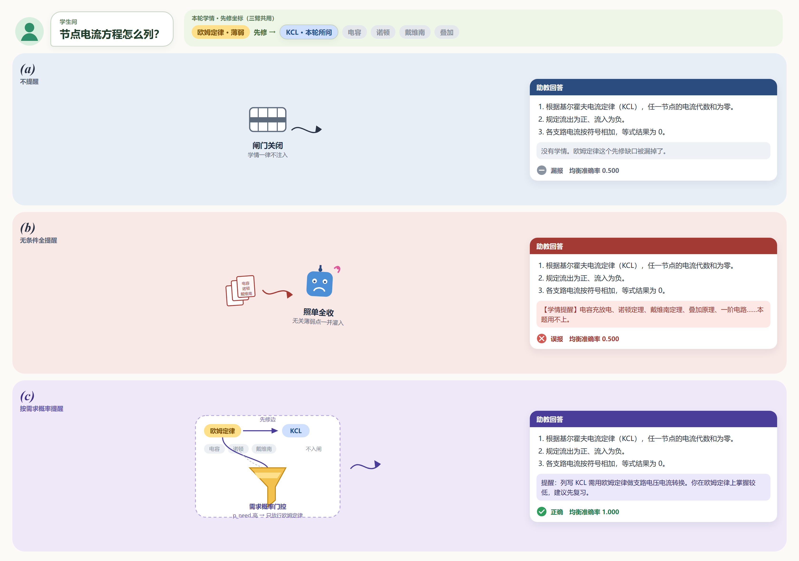

# 面向教学的课程助手智能体设计与实现

——以《电路分析基础实验》课程为例

**Design and Implementation of a Course-Specific Agent for Experimental Teaching: A Case Study of Fundamentals of Circuit Analysis Laboratory**

> 作者：×××，×××，×××（姓名、单位、邮编待补）
> 基金项目：×××（如有，待补；若列国家自然科学基金、国家重点研发计划或省级自然科学基金，须在文中提供项目名称、项目负责人及承担单位）
> 通信作者：×××，E-mail: ×××（第一作者为研究生时，须以导师为通信作者）
> 中图分类号：TP391；G642.423　　文献标识码：A

---

## 摘要

目的：解决电路基础实验课程中理论与操作脱节、课时内答疑集中、学习过程缺乏连续记录三个问题。方法：以工具调用驱动的推理—行动循环为统一调度内核，承载问答、解题、出题、研究四类能力；索引层按讲义版面特点采用标题层级栈驱动的结构化切分，并提供知识图谱与向量双后端按库选型；上下文治理按跨请求稳定性对提示词分层，并以有效上下文窗口实施预算规划与优先级驱逐；学习记忆按遗忘边界与更新代价分为三层，并按需求概率决定是否提醒尚未问及的薄弱点。结果：系统已在该课程完成部署，回答可追溯至讲义片段、资料未覆盖时显式拒答，推理全部经外部接口完成而无需图形处理器。结论：该设计可为同类课程智能体建设提供参考。

**关键词**：课程智能体；检索增强生成；结构化切分；上下文管理；实验教学

**Abstract**: Objective: To address three problems in fundamental circuit laboratory courses—the gap between theoretical statements and hands-on operation, the concentration of question-answering requests within limited lab hours, and the absence of a continuous record of the learning process. Methods: A tool-calling reasoning–acting loop serves as a unified scheduling kernel carrying four capabilities: question answering, problem solving, quiz generation and research. The indexing layer adopts heading-hierarchy-stack-driven structural chunking tailored to the layout of laboratory handouts, and offers a knowledge-graph backend and a vector backend that can be selected independently per knowledge base. Context governance stratifies the system prompt by cross-request stability and performs budget planning and priority-based eviction over an effective context window, while learning memory is divided into three layers according to forgetting boundaries and update cost, and a need probability decides whether to remind the student of unasked weak points. Results: The system has been deployed for the course Fundamentals of Circuit Analysis Laboratory. Answers are traceable to specific handout fragments, the system refuses to answer explicitly when the course material provides insufficient evidence, and all inference is performed through external service interfaces without requiring a local GPU. Conclusion: The design provides an engineering reference for building similar course-specific agents.

**Keywords**: course-specific agent; retrieval-augmented generation; structure-aware chunking; context management; experimental teaching

---

## 0　引言

随着大语言模型迅速发展，基于其构建的学习系统已进入高校教学环节，"课程助教"类系统正由概念验证走向工程落地。就现有公开报道，这类系统大致沿两条技术路线展开。

一是**参数微调路线**。陶飞飞等[1]以《操作系统原理》课程为实验对象，采用低秩适配方法微调开源模型，并利用大语言模型自动构造了约七千条课程指令数据集用于训练；张友衡等[2]针对《编译原理》课程实验，同样以微调开源模型为主要手段。该路线的优势在于模型输出风格与课程内容高度贴合，代价是课件更新即需重新构造数据并重新训练，单课程的边际成本较高，且模型内部知识与课程资料之间缺乏显式的对应关系，无法满足"结论出自哪一页讲义"这类可追溯性要求。

另一条路线是**检索增强生成路线**。张力军等[3]为《计算机网络》实验课程构建了二十万字规模的知识库，采用稀疏与稠密双路召回后做倒数排名融合，并设置多级规范性检测用于拒答；潘耀宗等[4]将知识图谱与文本向量并置为双路知识体系，按实验阶段设计不同的提示模板；张希坤等[5]进一步引入智能体框架，将前端交互、智能体调度、混合知识库与日志分析分层组织，并在实验班中开展对照观察。与本文课程类型最接近的是陈宇等[6]面向电力电子实验教学的工作，其以智能插件补足通用大模型对本领域符号系统与器件参数的理解缺口，说明电类实验课程的难点不在模型规模，而在领域资料的组织方式。

跨学科工作中，文献[7]提出在缺乏学生反馈时以历史提问自动构造测试集并结合专家校验的评估框架；文献[8]将模型上下文协议引入智能导学系统的多智能体编排。另有工作直接在低代码平台上搭建电路课程学伴[9]，其局限在于解析、切分、检索、拒答等关键环节不可控，难以针对课程特点定向优化，亦无法开展控制变量的对照分析。

综合来看，现有研究在单个功能层面已较完备，但在工程细节与系统智能化程度上仍有不足。多数工作将检索增强生成作为一个整体模块引述，而对最终检索效果影响较大的环节——讲义如何解析与切块、多路结果如何融合、证据不足时如何拒答——交代较少，这些细节恰恰决定系统能否被学生接受。真正意义上的课程助教也不应停留于一问一答，而须感知学生的知识水平与学习轨迹，并判断何时调用课程资料之外的工具。

在"感知学生状态并主动施以帮助"这一方向上，已有工作多着力于提高掌握度估计精度，诊断出即注入，且标签空间往往来自模型自身输出。问答到课程结构的映射方面，Medhat 等[23]以先修图将学生自由提问分类到封闭主题集，并将"沿先修边传播个体知识缺口"列为后续工作。本文接续这一空白：以教师可审计的课程主题清单为标签空间，对问句命中主题之外的先修薄弱点，按需求概率决定是否随本轮回答提醒；不声称首次提出学情状态建模或问答主题分类。

针对上述问题，本文以《电路分析基础实验》为案例课程，设计并实现了一个课程助手智能体系统，其核心贡献是一项主创新与若干支撑工作。

（1）主创新——跨会话学情拼接门控。已有课程助手多将跨会话学情在每轮回答中无条件注入，易造成答非所问。本文将"本轮是否提醒学生未问及的薄弱点"建模为可测试、可向教师解释的规则：以建库时抽取的课程先修主题图为坐标，由问句命中的主题回溯该生尚未掌握的先修内容，结合遗忘间隔与错题复发计算需求概率，再按需求高低决定保持沉默、作一句轻提醒或给出完整学情说明。该门控读侧为确定性规则，不含生成式模型调用。

（2）学情估计与课程结构层。建立课程级先修主题图（建库时抽取、教师可审计、运行时无生成式调用）；掌握度采用"感知与记账分离"——大模型仅在主题清单内作可弃权、须附原文引用的等级判定，数值由确定性等级分规则根据观测记录逐条更新得出，结论可溯源至具体对话或答题证据。掌握度估计沿用教育数据挖掘的成熟做法，不作为本文创新。

（3）工程基座。包括以工具调用驱动的统一调度内核（承载问答、解题、出题、研究四类能力）、针对实验讲义版面的标题层级栈结构化切分、向量与知识图谱双索引后端及三层拒答门控、按跨请求稳定性分层的上下文预算治理与三层学习记忆；该基座既是独立可用的课程助手，也是上述门控得以运行的载体。

---

## 1　教学需求分析

《电路分析基础实验》是电类专业的核心基础实验课程，课程内容覆盖欧姆定律、基尔霍夫电流与电压定律、叠加定理、戴维南与诺顿等效、一阶电路暂态响应等知识点，要求学生既理解定律与等效变换的理论表述，又能完成接线、测量、记录与误差分析等操作环节。结合课程教学实际，系统建设面向三个具体问题。

**问题一：理论表述与实验步骤之间缺乏可操作的中间层。** 学生在课堂上能够复述定理内容，但在实验台前往往不清楚测量顺序、不理解某一步骤的目的，测量结果与理论值不符时缺乏排查思路，最终表现为跟做实验、报告模板化。系统需要能够针对具体实验任务给出分步推导与操作提示，而非仅复述教材定义。

**问题二：实验课时内答疑请求高度集中。** 实验课通常多组学生同时进行，同一时段内的提问在时间上高度集中且在内容上高度重复。基础较弱的学生反复卡在同类问题上，基础较好的学生希望获得更深入的推导，仅靠教师现场巡回难以兼顾。系统需要承接共性问题的即时应答，使教师的时间可以投向关键问题诊断。

**问题三：学习过程缺乏跨阶段的连续记录。** 学生在预习、实验、复盘三个阶段的提问与易错点分散在不同媒介中，既无法在后续交互中被复用，也难以为教师的分层指导提供依据。系统需要在会话内与跨会话两个尺度上沉淀学习轨迹，并在后续回答中体现。

由上述问题导出四项设计目标：回答须可追溯到课程资料中的具体片段；课程资料未覆盖时须明确拒答而非以通用知识强答；交互过程须可视、可中断，以适配实验课堂的即时反馈节奏；系统须能够在无图形处理器的低配服务器上长期运行，以匹配院系实验室的部署条件。

---

## 2　系统总体架构与功能组织

系统采用前后端分离架构，前端基于 React 与 TypeScript 实现课程选择、会话管理与流式渲染，后端基于 FastAPI 实现接口层与调度层，以 PostgreSQL 承载业务数据与向量数据、以 Redis 承载缓存与任务队列。

总体处理流程如图 1 所示。用户请求进入后，调度层先按前端指定的能力类型完成路由，随后统一进入共享的推理—行动循环内核；内核执行过程中读取该用户的分层记忆作为上下文补充，按需调用课程知识库检索、联网搜索等工具，执行结束后将本轮交互的增量信息写回记忆存储。

**图 1　系统总体架构**

系统面向用户提供四类功能入口，由前端指定问答、解题、出题或研究，定位与执行方式如表 1 所示。四类能力建立在同一套调度内核之上，差异仅在于各自配置的工具集合与阶段划分。由此，内核层的可靠性改进（超时处理、异常兜底、上下文预算治理、成本记账）对四类能力同时生效，无需维护多套编排逻辑。

**表 1　四类功能的定位与执行方式**

| 功能 | 定位 | 执行方式 |
|---|---|---|
| 问答 | 面向课程内容的多轮交互问答，回答优先基于检索到的课程资料 | 单次循环执行，提炼用户关键词后按需调用检索、联网搜索等工具 |
| 解题 | 面向需要多步骤推导的问题，要求先给出完整计划再逐步执行 | 单次循环配合独立于模型推理的计划状态机，强制"先规划、再执行、不可跳步"，重新规划次数受上限约束 |
| 出题 | 按要求自动生成练习题目 | 三阶段：素材检索、蓝图规划（确定题目数量与题型）、题目并行生成 |
| 研究 | 面向指定主题的深入调研，产出附带引用来源的报告 | 四阶段：主题澄清、子问题拆分、并行检索取证、报告生成 |

---

## 3　关键技术设计

### 3.1　多能力共享的调度内核

调度内核采用以工具调用驱动的推理—行动循环[10]：模型在每一轮自主判断是否需要调用工具，需要则执行调用并观测结果，据此决定继续调用还是给出最终回答；模型不再发起工具调用时循环结束。内核对外只产出与传输方式无关的事件（阶段起止、模型增量输出、工具调用状态、最终答案），因而同一套执行逻辑可同时支撑网页问答的 HTTP 单向流式响应，以及深度能力中澄清反问、任务取消、追加输入等 WebSocket 全双工交互。

### 3.2　面向实验讲义的结构化解析与切分

本课程实验讲义文档的版面特征是：章节层级明确、存在大量表格承载关键参数（元件规格、量程设置、测量记录格式）、图文混排比例较高。早期实现按固定字数机械切分，不感知标题层级与表格结构，导致大段表格被从中间截断、片段脱离所属章节语境。

改进后的方案由三部分构成。首先，解析层将 PDF、DOCX、PPTX 等格式统一转换为带章节层级与页码元数据的结构化中间表示（Markdown），其中 PDF 引入版面分析与表格结构识别以替代按页面顺序提取文本的做法[11]，并按标题层级完成分节——解析只负责还原结构，不涉及切分。其次，切分层引入标题层级栈，以文档自身的章节层级约束切分边界，并将表格作为独立单元整体保留，以避免跨行截断；层级感知切分相较于固定字数切块对检索准确度的提升已在长篇工业文档场景得到验证[12]，实验讲义在"章节层级明确、表格承载关键参数"两点上与该场景同构，故本文沿用其切分边界约束思路。文档中被识别到的图片采用视觉语言模型生成描述文本并拼入所属片段。最后，切分粒度调整为更小的可配置参数，同时为每个片段补充上下文摘要，说明该片段在原文中的位置与背景，以补偿粒度变小带来的语境损失（见图 2）——已有实践表明，为片段补充其在全文中的定位信息可使检索失败率由 5.7% 降至 3.7%[13]。

**图 2　为切块补充背景与定位信息的前后对照**

### 3.3　双索引后端与检索路由

课程内容的检索需求并不单一：部分问题需要跨知识点的关系推理（如"戴维南定理与诺顿定理之间有何联系"），另一些问题只需定位某一知识点的原文表述（如"实验三中电流表的量程如何设置"）。两类需求对应不同的索引构建方式，对构建成本与检索能力的要求不同，单一方案难以同时满足，因此系统允许每个知识库独立选择索引后端，二者对比见表 2。

**表 2　两种索引后端的特性对比**

| 维度 | 知识图谱索引 | 向量索引 |
|---|---|---|
| 索引原理 | 逐文本块调用大模型抽取实体与关系并建图 | 复用已切分文本块，仅做向量编码 |
| 构建耗时 | 随语料规模近似线性增长，大规模课件需数小时 | 分钟级，可批量并发 |
| 检索能力 | 图谱邻域扩展结合向量检索，支持多跳关系推理[14] | 稠密与稀疏并行召回后融合，面向精确事实检索 |
| 适用场景 | 需跨材料综合推理的课程 | 课件规模大、以事实定位为主的课程 |

向量存储选用关系数据库的向量扩展，而非独立的专用向量数据库：在本项目的向量规模内，其近似最近邻检索性能已经足够，且索引与业务数据统一存储可避免额外运维与硬件开销，这一权衡更贴合院系实验室的部署条件。检索模式可由用户指定，分别走图谱增强检索与向量检索两条路径。

### 3.4　混合检索、排名融合与交叉编码器精排

稠密检索把提问与文档均嵌入为向量后做余弦相似度检索，能查到语义相近但措辞不同的内容；稀疏检索则对器件型号、编号、专有名词等精确词汇的召回更可靠，二者互补。系统对两路分别独立查询后做倒数排名融合（RRF）[15]，片段 d 的融合得分取

　　score(d) = Σ_i 1 / (k + rank_i(d))　　(1)

式中 rank_i(d) 为片段 d 在第 i 路召回结果中的排名。该式只用排名不用原始分数，因而稀疏与稠密两路的分数尺度无需对齐；由于两路面向同一存储表、片段标识天然一致，融合亦无需额外的跨存储对齐步骤。

多路召回解决的是不漏信息，融合解决的是初步排序，但 RRF 仍基于各路召回器的独立打分。交叉编码器则把查询与每个候选片段一并送入模型，直接输出相关性分数；因其只对少量候选做一次前向计算，相对于流水线中的大模型调用，延迟开销可以忽略。

召回与精排解决"找得到"，教学场景更关键的是"找不到时不要硬答"。已有研究表明，与问题无关的检索噪声会明显拉低回答准确性[16]，因此系统在精排之后设置三层门控：无命中判定层在召回为空时直接拒答，工具层约束模型在未返回有效证据时不得自行作答，二者常开；相关性阈值层默认关闭，须在开启精排并完成分数标定后启用，以免未标定的阈值把正确片段一并滤除。

### 3.5　上下文预算治理与提示词分层

多轮工具调用会使消息列表迅速膨胀，而模型真正有效的上下文窗口显著小于其标称值：重要线索位于序列首尾时模型能够可靠利用，但对中间位置关键信息的提取能力大幅下降，即"Lost in the middle"现象[17]；长上下文基准的实测进一步显示，全部受测模型均声称支持 32K 以上上下文，但仅约半数能在 32K 长度维持质量阈值，且几乎所有模型在达到标称长度前就已跌破阈值[18]。基于此，本系统作以下两项设计。

**提示词分层。** 系统提示词由执行规范、课程配置、技能说明、工具提示、跨会话记忆、会话摘要等来源拼接而成，拼接顺序按"跨请求稳定程度"从高到低排列：全局恒定的在最前，课程级与用户级配置次之，每次请求都可能变化的记忆与时间放在最后。由于键值缓存只能复用请求间完全一致的前缀，这一排序可最大程度提高前缀缓存命中率，从而同时改善首字延迟与 token 消耗。

**回合与轮内预算。** 系统设置安全线与质量线两条阈值：安全线由模型标称窗口扣除输出预留与安全余量得到，是触及模型超界后拒绝回答的边界；质量线显著低于安全线，越过它便启动自动压缩。两条线均由标称窗口按比例换算，而非取固定值，从而在缓解标称窗口与有效窗口落差[18]的同时，仍能利用长窗口模型的容量。一轮问答开始前依据质量线规划历史消息：未超阈值时不作裁剪；超出且已有会话摘要时裁切为质量线的一半，否则裁切到质量线。轮内则在每次模型调用前按代价递增压缩：先将更早轮次的工具结果按优先级清理为掩码标记（保留最近若干轮，携带来源引用的检索结果优先保留），以十余字掩码替换数千字的原始工具输出，可在不丢失对话语义的前提下降低预算，且其成本收益优于整段摘要压缩、不易拉长任务轮数[19]；若仍超质量线，再追加一次大模型调用将被清理内容折为摘要；若仍超安全线，则丢弃最旧消息以保证请求可送达。

### 3.6　三层学习记忆

记忆系统按遗忘边界与更新方式划分为三层，写入与读取路径如图 3 所示。

**图 3　三层学习记忆的写入与读取路径**

**L1 短期记忆**保留最近原文，按当前模型上下文容量换算出的 token 预算从新到旧累加并截断，窗口长度随所选模型自适应调整。**L2 会话摘要**在原文滑出窗口后触发：以游标记录已压缩位置，每轮只增量处理新滑出的一小段，由大模型按预定义结构（讨论主题、已达成结论、确认的事实、未解决问题、后续约定）抽取，再由代码归一化去重合并，每类按条数上限保留最近若干项。**L3 长期记忆**跨会话保留学生的事实性片段（讲解偏好、学习目标与考试节点、器材与时间约束等）：写入先进入按用户与会话分桶的缓冲队列，由后台任务在重要度累积达阈值或静默超时后批量处理——以话题分段而非单轮对话作为构建粒度并配合压缩去噪，可同时提升检索准确率与内容的语义完整性[20]；抽取受白名单约束，明确排除掌握度结论与题目内容（掌握度由 §3.7 的观测记录承载，二者职责分离）；读取在语义检索之外叠加矛盾抑制，对文本相似度超阈值且写入间隔超过最小天数的两条记忆只注入较新一条，以弥补所用开源记忆库抽取链路为追加式、无原生更新操作的缺陷。记忆分层的总体思路借鉴了将上下文窗口类比为分级存储的架构[21]，差异在于层间流转由确定性规则触发，而非交由模型自主决定，以便测试。

### 3.7　学情模块与学情拼接门控

学情模块给出学生在各课程主题上的掌握程度，一是供界面展示，二是供问答时判断是否提醒尚未问及的薄弱点。大模型仅作等级判定，数值更新与提醒决策均由确定规则完成，结论可追溯至具体对话或答题记录。

建库时一次性抽取本课主题清单及先修关系。运行中，大模型在清单内对对话判定为未掌握、部分掌握或已掌握，答题对错按同一口径计为对或错；每条判定或作答写入一条观测记录（含主题、结果、来源、时间及原文依据），记录只追加不覆盖。再按教育数据挖掘中常用的等级分规则，依时间顺序根据上述记录计算当前掌握度[24]；最后结合距上次练习的间隔，决定本轮保持沉默、作一句轻提醒，或给出完整学情说明。

**课程结构与判定。** 主题及先修关系在教师建立知识库索引时抽取、去重后落库，运行时只读，从而保证先修边可测试、跨学生一致。若在问答过程中临时推断前置关系，则边不可单独验证，且不同学生可能得到不同结构。后台任务将对话按主题连续段切分，每段作一次判定：模型对命中主题输出上述三档或弃权，并附原文引用。答题对错经主题匹配后，作为第二类证据写入同一观测记录表。

**掌握度估计。** 掌握度不由模型直接写出，而根据该生在该主题上的全部观测记录，按时间先后逐条更新能力值 θ 得到。记学生能力为 θ、主题的班级难度为 b，初值均为 0，则期望正确率即掌握度

　　p = 1 / [1 + exp(−(θ − b))]　　(2)

薄弱程度 risk = 1 − p。尚无证据时 p = 0.5。每读入一条观测，将等级映射为 y（未掌握、部分掌握、已掌握分别为 0、0.5、1），按实测相对预期的偏差更新能力：

　　θ ← θ + w·U(n)·(y − p)，　U(n) = max(0.03, 1 / (1 + 0.05n))　　(3)

其中 w 为证据权重（答题 1.0，对话判定 0.6），n 为已有观测条数，U(n) 随 n 递减并设下界，使初期更新幅度较大、长期仍保持小幅调整[24]。班级难度 b 以同类公式按全班记录定期重估；证据不足时按中等难度处理，以免少数记录造成误判。仅当同一主题至少两次被判定为未掌握时，该主题才允许作为提醒对象。

**学情拼接门控。** 跨会话学情不在每轮无条件注入。本轮只考虑两类情形。其一为先修薄弱点：学生当前所问主题的先修内容中，该生已两次被判定为未掌握的部分（所问主题本身不计）。其二为错题复发：所问主题在近 30 天内至少两次被判定为未掌握。与本题无先修关系的其他薄弱点，即使该生不会，本轮也不提醒。

对先修薄弱点还须考虑距上次练习的间隔。受艾宾浩斯遗忘曲线，以及memorybank的记忆更新启发[25]，设定遗忘曲线，记间隔为 t 天、记忆强度为 S（初值 5 天，强化后增大），则

　　p_forget = 1 − exp(−t / S)　　(4)

　　p_need = risk × p_forget　　(5)

p_need 表示此刻需要被提醒的程度。刚完成判定时 t 近于 0，不预警；间隔较长时方予提醒。错题复发不乘式(4)，直接按其薄弱程度计。按 p_need 决定本轮是否提醒及提醒粒度：较低则保持沉默，中等则作一句轻提醒，较高则给出完整学情说明。

### 3.8　技能与外部工具的渐进式披露

随着可用工具与课程技能的增多，若将全部工具描述常驻于系统提示中，上下文长度将随技能数量线性增长，且大部分描述在单次会话中并不会被使用。故系统采用渐进式披露：系统提示词中默认只提供技能的简要描述与工具名称提示，当模型判断需要调用某项能力时，再通过内置的工具加载接口获取完整说明。除内置工具外，系统还通过模型上下文协议（MCP）接入外部工具，由网关进程统一维持连接、管理员侧统一部署、学生侧按需开启，其在系统提示中同样只写入分组后的名称与简短描述。协议化的工具接入便于后续拓展仿真、检索、计算等外部能力[8]。

---

## 4　系统实现与部署

系统以容器编排方式部署，常驻五个服务：数据库（含向量扩展）、缓存与任务队列、Web 服务进程组、后台任务进程、前端静态服务。大模型推理与向量编码全部经外部服务商接口完成，本地不做任何模型部署、无需图形处理器，符合院系实验室的常规资源条件。知识库构建等长耗时任务交由后台队列执行，不占用用户请求链路，并按"知识库＋索引后端"划分锁粒度，使同一知识库的两种索引可并行构建；此类任务被设计为可重复执行且结果一致，因此失败自动重试不会产生重复数据。

成本方面，每一轮循环的 token 用量在调度内核这一唯一出口处采集，按用户、课程、会话三个维度落库，用于按人按课查询用量；当日累计成本超出预算时，系统降级到更低成本的模型档位而非直接拒绝服务，以避免"上一轮刚好超限、下一轮被完全锁死"的可用性问题。

---

## 5　评测方案

### 5.1　切分质量评测（RAGAS）

本评测基于检索增强生成自动评测框架 RAGAS[22]，报告与切分质量直接相关的三项：上下文精确度（检索片段中与问题相关的比例）、上下文召回率（标准答案中的信息被检索证据覆盖的比例）、忠实度（生成陈述可被检索证据支撑的比例）。

评测集由人工编写的 27 道电路实验问答题构成，覆盖事实、关联、推理、比较四类认知维度，标准答案均取自《电路分析基础实验》讲义。检索后端固定为向量检索，回答与阅卷分别由两种不同大模型完成。

此评测主要为检验 §3.2 的结构化切分，设置唯一变量对照：同一套原始讲义、同一摄入粒度、均保留图片描述文本，仅切换切分策略。对照组为按固定字数的句子切分，实验组为改进后的标题层级切分。

**表 3　固定字数切分与结构化切分的 RAGAS 对照（向量混合检索，n=27）**

| 指标         | 固定字数切分 | 结构化切分 | 变化                   |
| :----------- | :----------- | :--------- | :--------------------- |
| 上下文精确度 | 1.000        | 1.000      | 持平                   |
| 上下文召回率 | 0.889        | 0.917      | +0.028（相对约 +3.1%） |
| 忠实度       | 0.950        | 0.969      | +0.019（相对约 +2.0%） |

### 5.2　学情拼接门控评测

学情侧评测分决策层（门控对错）与估计层（判定器与金标的一致性）两层。

**门控三臂对照。** 以 9 个人工编写的电路实验跨会话场景为评测集（正例：先修薄弱点、深层先修薄弱点、错题复发、二者叠加；负例：未命中主题、无关薄弱点、已纠正、需求很低、阶段错位），三臂在同一巩固链路（判定→观测更新→门控）上对比，以均衡准确率（正负两类的平均正确率）为主指标，结果见表 4；图 4 给出同一问句下不提醒、无条件全提醒与按需求概率提醒三种策略的输出对照。

**表 4　学情拼接门控三臂对照（n=9）**

| 臂 | TP | FN | FP | TN | 均衡准确率 |
| :--- | :-: | :-: | :-: | :-: | :--------: |
| 不提醒 | 0 | 4 | 0 | 5 | 0.500 |
| 无条件全提醒 | 4 | 0 | 5 | 0 | 0.500 |
| 按需求概率提醒 | 4 | 0 | 0 | 5 | **1.000** |

**图 4　同一问句下三种拼接策略的输出对照**

两基线的 0.500 即随机水平：不提醒漏掉全部正例，全提醒吃进全部负例。需求概率门控在本评测集上未失手。须说明的是，9 例为人工构造场景、规模有限，档位划分与课堂效果留待更大规模标注与准实验进一步检验。

**估计层与限制。** 判定器质量以人工标注 200 个（对话段, 主题）对的等级为金标，对比关键词规则、闭集序数判定与自由输出掌握度增量三条路线，主指标为二次加权 kappa（序数一致性）与"未掌握"类精确率，另报弃权率、引用校验失败率与每段 token 成本；语料的生成模型须异于判定模型，以免同源用词与错误类型抬高判定器的 kappa。决策规则事先约定：序数判定臂的 kappa 须显著高于另两臂方予采用，其观测权重取实测 kappa 而非手工指定。系统上线后另以答题判分为金标校准，把掌握度作为对后续首次同主题答题结果的预测，报告 AUC 与 Brier 分数。该部分标注尚在进行，在无真实判分数据前如实列为限制。掌握度路径不声称零模型调用，声称的是每主题段一次约束判定替代每轮一次开放抽取，随评测一并报告每段 token 用量。

---

## 6　结论与展望

本文以《电路分析基础实验》为案例课程，设计并实现了一个课程学习助手智能体系统：教师上传课件等材料即可建立课程知识库，学生通过课程码加入后开展该门课程的学习问答。系统以推理—行动循环为统一调度内核承载四类教学能力；检索子系统针对课件版面特点实现结构化解析与切分，提供双索引后端供灵活选型，并以三层门控实现证据不足时的显式拒答；上下文预算治理与三层学习记忆面向长时间交互中的成本控制与个性化需求，并在此基础上按需求概率决定是否提醒尚未问及的薄弱点。

后续工作从三个方向推进。其一，完成切分粒度的系统性消融与双索引后端在同一评测集上的对比验证，当前粒度取值来自首轮实验的候选值，尚需与其他候选值系统对比。其二，针对推理类问题的多跳检索能力开展专项改进，该类问题需要跨越多个知识点串联因果链条，是当前检索策略的能力边界所在。其三，开展课堂准实验验证，拟采用对照组与实验组设计，以预习成绩、实验操作错误率、任务完成时间与实验报告质量为观测指标，在同一任课教师、同一实验项目条件下开展一学期的对比观察，并同步采集会话日志与拒答率，用于交叉验证离线评测结论与真实教学效果的一致性。

---

## 参考文献

[1] 陶飞飞, 张优优, 邓劲柏, 等. 基于大语言模型的"操作系统原理"实验教学辅助系统[J]. 实验技术与管理, 2026, 43(2): 212-218.
TAO F F, ZHANG Y Y, DENG J B, et al. Experimental teaching assistance system for "Principles of Operating System" based on large language models[J]. Experimental Technology and Management, 2026, 43(2): 212-218. (in Chinese)

[2] 张友衡, 熊莹, 周放, 等. 基于微调 StarCoder2 大模型的"编译原理"课程实验系统[J]. 实验技术与管理, 2025, 42(4): 227-232.
ZHANG Y H, XIONG Y, ZHOU F, et al. Experimental system for the course "Principles of Compilers" based on the fine-tuned StarCoder2 large model[J]. Experimental Technology and Management, 2025, 42(4): 227-232. (in Chinese)

[3] 张力军, 刘偲, 廖纪童, 等. 基于大模型检索增强生成的计算机网络实验课程问答系统设计与实现[J]. 实验技术与管理, 2024, 41(12): 186-192.
ZHANG L J, LIU C, LIAO J T, et al. Design and implementation of a question answering system for computer network laboratory courses based on large model retrieval-augmented generation[J]. Experimental Technology and Management, 2024, 41(12): 186-192. (in Chinese)

[4] 潘耀宗, 刘凯, 于柯远, 等. 基于检索增强生成的计算机实验指导平台设计与实践[J]. 实验技术与管理, 2025, 42(4): 213-219.
PAN Y Z, LIU K, YU K Y, et al. Design and practice of a computer experiment guidance platform based on retrieval-augmented generation[J]. Experimental Technology and Management, 2025, 42(4): 213-219. (in Chinese)

[5] 张希坤, 侯洁, 谢统薇. 利用 AI Agent 提升学生实验自学与故障诊断能力的系统开发[J]. 实验技术与管理, 2026, 43(4): 243-250.
ZHANG X K, HOU J, XIE T W. Development of a system for improving students' experimental self-learning and fault diagnosis ability using AI agents[J]. Experimental Technology and Management, 2026, 43(4): 243-250. (in Chinese)

[6] 陈宇, 陈汉文, 祝之森, 等. 基于智能插件和大语言模型的电力电子实验教学辅助设计方法[J]. 实验技术与管理, 2025, 42(4): 205-212.
CHEN Y, CHEN H W, ZHU Z S, et al. Auxiliary design method for power electronics experimental teaching based on intelligent plug-ins and large language models[J]. Experimental Technology and Management, 2025, 42(4): 205-212. (in Chinese)

[7] HUA L X, GUO L R, ZHENG N, et al. Proactive framework for evaluating retrieval-augmented generation-based learning assistants in engineering education[J]. Computer-Aided Civil and Infrastructure Engineering, 2025, 40(26): 4651-4668. DOI: 10.1111/mice.70063.

[8] MODRAN H A. Leveraging RAG with ACP & MCP for adaptive intelligent tutoring[J]. Applied Sciences, 2025, 15(21): 11443. DOI: 10.3390/app152111443.

[9] 王子健, 张梦达, 赵伟强, 等. 《电路智导》AI 学伴的创建研究[J]. 人工智能与机器人研究, 2026, 15(1): 78-86.
WANG Z J, ZHANG M D, ZHAO W Q, et al. Research on the creation of the "Circuit Intelligent Guidance" AI learning companion[J]. Artificial Intelligence and Robotics Research, 2026, 15(1): 78-86. (in Chinese)

[10] YAO S, ZHAO J, YU D, et al. ReAct: synergizing reasoning and acting in language models[C]//The Eleventh International Conference on Learning Representations (ICLR 2023). Kigali, 2023. arXiv:2210.03629.

[11] LIVATHINOS N, AUER C, LYSAK M, et al. Docling: an efficient open-source toolkit for AI-driven document conversion[C]//AAAI-25 Workshop on Open-Source AI for Mainstream Use. Philadelphia, 2025. arXiv:2501.17887.

[12] SHIN J, PARK C, PARK J, et al. MultiDocFusion: hierarchical and multimodal chunking pipeline for enhanced RAG on long industrial documents[C]//Proceedings of the 2025 Conference on Empirical Methods in Natural Language Processing. Suzhou: ACL, 2025: 20985-21004. DOI: 10.18653/v1/2025.emnlp-main.1062.

[13] Anthropic. Introducing contextual retrieval[EB/OL]. 2024-09-19[2026-08-15]. https://www.anthropic.com/news/contextual-retrieval.

[14] EDGE D, TRINH H, CHENG N, et al. From local to global: a graph RAG approach to query-focused summarization[EB/OL]. arXiv:2404.16130, 2024[2026-08-15]. https://arxiv.org/abs/2404.16130.

[15] CORMACK G V, CLARKE C L A, BÜTTCHER S. Reciprocal rank fusion outperforms condorcet and individual rank learning methods[C]//Proceedings of the 32nd International ACM SIGIR Conference on Research and Development in Information Retrieval. Boston: ACM, 2009: 758-759. DOI: 10.1145/1571941.1572114.

[16] WU J, ZHANG S, CHE F, et al. Pandora's box or Aladdin's lamp: a comprehensive analysis revealing the role of RAG noise in large language models[C]//Proceedings of the 63rd Annual Meeting of the Association for Computational Linguistics (Volume 1: Long Papers). Vienna: ACL, 2025: 5019-5039. DOI: 10.18653/v1/2025.acl-long.250.

[17] LIU N F, LIN K, HEWITT J, et al. Lost in the middle: how language models use long contexts[J]. Transactions of the Association for Computational Linguistics, 2024, 12: 157-173. DOI: 10.1162/tacl_a_00638.

[18] HSIEH C P, SUN S, KRIMAN S, et al. RULER: what's the real context size of your long-context language models?[C]//Conference on Language Modeling (COLM 2024). Philadelphia, 2024. arXiv:2404.06654.

[19] LINDENBAUER T, SLINKO I, FELDER L, et al. The complexity trap: simple observation masking is as efficient as LLM summarization for agent context management[C]//4th Deep Learning for Code Workshop (DL4C) at NeurIPS 2025. San Diego, 2025. arXiv:2508.21433.

[20] PAN Z, WU Q, JIANG H, et al. SeCom: on memory construction and retrieval for personalized conversational agents[C]//The Thirteenth International Conference on Learning Representations (ICLR 2025). Singapore, 2025. arXiv:2502.05589.

[21] PACKER C, WOODERS S, LIN K, et al. MemGPT: towards LLMs as operating systems[EB/OL]. arXiv:2310.08560, 2023[2026-08-15]. https://arxiv.org/abs/2310.08560.

[22] ES S, JAMES J, ESPINOSA ANKE L, et al. RAGAs: automated evaluation of retrieval augmented generation[C]//Proceedings of the 18th Conference of the European Chapter of the Association for Computational Linguistics: System Demonstrations. St. Julians: ACL, 2024: 150-158. DOI: 10.18653/v1/2024.eacl-demo.16.

[23] MEDHAT Y, PARK J, THAJCHAYAPONG P, et al. Detecting knowledge gaps from conversational AI interactions using curriculum prerequisite graphs[C]//Proceedings of the 10th CSEDM Workshop co-located with the 18th International Conference on Educational Data Mining (EDM 2026). 2026. arXiv:2606.10736.

[24] PELÁNEK R. Applications of the Elo rating system in adaptive educational systems[J]. Computers & Education, 2016, 98: 169-179. DOI: 10.1016/j.compedu.2016.03.017.

[25] ZHONG W, GUO Z, LI Q, et al. MemoryBank: enhancing large language models with long-term memory[C]//Proceedings of the AAAI Conference on Artificial Intelligence. Vancouver: AAAI, 2024: 19724-19731. arXiv:2305.10250.
